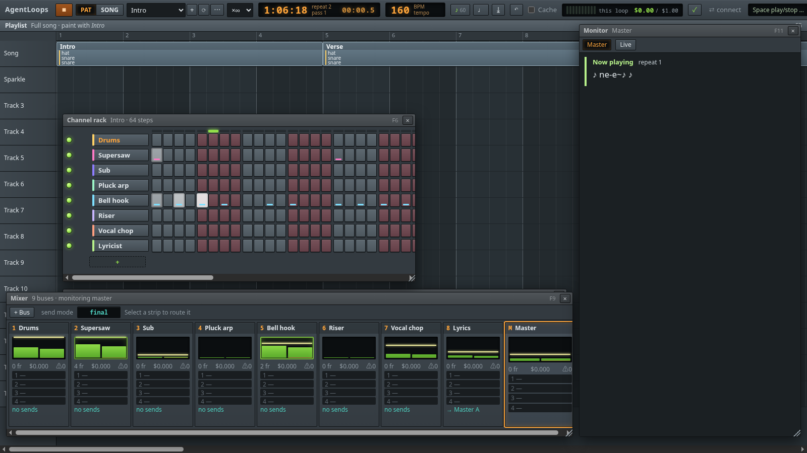

# AgentLoops

**FL Studio, but for AI agents.** A song is a multi-agent pipeline you can see, hear and edit like a beat. Channels are agents, notes are agent calls, patterns loop, mixer buses carry each agent's output to the next one, and what reaches Master is the result. A song is also music: every channel has an instrument, so a song plays as you build it and exports to WAV or MP3.

Use it from **Claude Code**, Codex, Cursor, opencode or any MCP client. The coding agent drives the studio through the Studio MCP server, and you watch each edit land in the studio window. You don't need an API key. `script` channels run locally, and `harness` channels hand their notes to your coding agent. Only `llm.agent` channels call the Claude API.



## Requirements

- **Node.js 24** or newer.
- A Chromium-family browser (Chromium, Chrome, Brave or Edge) for the app window and for exporting audio with no studio open. Without one, the studio opens in your default browser.
- `ffmpeg`, optional, for MP3 export. WAV needs nothing extra.

## Install

```sh
npm install -g @nawka12/agentloops
```

That gives you the `agentloops` command. To try it without installing, use `npx @nawka12/agentloops <command>`.

Straight from GitHub:

```sh
npm install -g --allow-git=root github:nawka12/agentloops
```

npm 12 refuses git installs unless you allow them, and `--allow-git=root` allows only this one. If npm then warns that the package's `prepare` script was blocked, you can ignore it: the package was already built while it was installed.

From a clone:

```sh
npm install   # also builds dist/
npm link
```

You can also skip the install and run `node src/cli.ts <command>` from the clone.

## Make a song with Claude Code

```sh
agentloops init my-song --harness claude-code   # a starter song, .mcp.json and the AgentLoops skill
cd my-song
agentloops studio song.alp.json                 # opens the studio in its own window
```

In a second terminal, in the same folder:

```sh
claude                                          # approve the "agentloops" MCP server when asked
```

Then ask for what you want:

> Make a kawaii future-bass song at 160 BPM: a supersaw chord stab, a wobbly sub bass, chip arps and a lyric line. 16 bars with an intro, a build and a drop. Play it for me, then export it as an MP3.

The agent reads the manual from its skill, writes the song, plays it and exports the MP3. Every change shows up in the studio, labeled with who made it, and **Ctrl+Z** undoes any of them. You can keep editing in the studio at the same time: the agent sees your changes on its next read.

Other harnesses use the same setup with a different `--harness`:

| `--harness` | Writes | Then |
|---|---|---|
| `claude-code` | `.mcp.json`, `.claude/skills/agentloops/SKILL.md` | run `claude` |
| `codex` | `AGENTS.md`, `.codex/config.toml` | run `codex` and trust the project |
| `cursor` | `AGENTS.md`, `.cursor/mcp.json` | turn the server on in Settings → Tools & MCP |
| `opencode` | `AGENTS.md`, `opencode.json` | run `opencode` |
| `other` | `AGENTS.md`, plus a command to paste into your client's MCP settings | |

The studio's **⇄ connect** button writes the same files for the song that is open.

## Try the demo

```sh
agentloops studio "$(npm root -g)/@nawka12/agentloops/examples/kawaii-bass.alp.json"
```

Press **Space** to play. **Shift+click ⤓** saves an MP3 next to the song. It is 52 bars, with 8 script channels for chords, bass, arp, bell hook, drums, riser, vocal chops and a lyricist. The lyricist listens to the vocal chops and sends each sung line to Master, so the Monitor (F11) shows the lyrics as they're sung.

## Commands

| Command | What it does |
|---|---|
| `agentloops init [dir] --harness <id>` | Create a song folder wired to a harness |
| `agentloops studio [file]` | Open the studio. With no file it opens `~/AgentLoops`. `--browser` uses a normal tab, `--no-open` opens nothing |
| `agentloops mcp --project <file>` | The Studio MCP server on stdio, which harnesses start for you. It relays to an open studio or runs headless |
| `agentloops validate <file>` | Check a song and explain each error with a fix |
| `agentloops render <file>` | Run the song with no UI and print what reached Master |
| `agentloops score <file>` | Print the arrangement and patterns as a text step grid |
| `agentloops install` | Linux: add AgentLoops to the app menu and open `*.alp.json` files with it |

## How it works

- **The studio is the host.** `agentloops studio` holds the song, the undo history and the runs. `agentloops mcp` relays every tool call to the open studio over localhost, using a token the studio writes to `.agentloops/studio.json`. With no studio open, it hosts the song itself.
- **Three scopes.** `read` can only look. `edit` can change the song, and every change is saved and undoable. `run` can also play the song, which spends money if it has `llm.agent` channels, so runs are capped by the song's budgets and the `--budget` the harness was started with.
- **Time is barriers.** Notes at the same position run in parallel, and a note starts only after every note ending at or before it has finished. Playback tempo is a speed limit, so a slow agent shows up as a held note.
- **Takes are cached.** Every run is saved as a take in `.agentloops/takes.sqlite`. A voice whose prompt and inputs did not change replays from the cache for free, which is what makes looping a pattern cheap.
- **Generators.** `script` runs JavaScript in a sandbox. `llm.agent` calls Claude with tools and MCP servers. `harness` hands a note to the connected coding agent: the run pauses until the agent answers with `voice_reply`.

## Docs

- [docs/manual.md](docs/manual.md): the manual for agents and people, covering the project format, every MCP tool and how to make music. `init` copies it into the skill or `AGENTS.md`.
- [SPEC.md](SPEC.md): the full design, with the FL Studio research behind it.
- [docs/case-study-blender-mcp.md](docs/case-study-blender-mcp.md): why the studio is the MCP host.

## Credits

The `piano` and `sax` sounds are recordings: Salamander Grand Piano by Alexander Holm (CC BY 3.0) and the University of Iowa Musical Instrument Samples. Details in [ui/samples/NOTICE](ui/samples/NOTICE).
